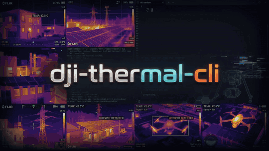

<p align="center">
  
</p>

# dji-thermal-cli

Batch-process DJI R-JPEG thermal images into temperature images (float32 TIFF or OpenEXR,
16-bit TIFF or PNG), raw sensor frames, and 16-bit grayscale or pseudo-color views.

Temperatures and pseudo-color images come from a pure-Python port of the DJI Thermal SDK
v1.8. Its results are bit-for-bit identical to the SDK's `dirp_measure_ex` and `dirp_process`,
and it needs neither the SDK nor any native library.

This does **not** rewrite the original R-JPEG: DJI bakes its environmental
parameters into a binary APP4 block at capture time that isn't writable by
the SDK. Every command below only reads originals and/or writes new
derivative files.

## Install

```
pip install dji-thermal-cli
```

or as a stand-alone command with `uv tool install dji-thermal-cli` or
`pipx install dji-thermal-cli`. It needs Python 3.14 or newer; numpy and Pillow are its only
dependencies. Neither the DJI Thermal SDK nor any native library is needed. It runs on
Linux, Windows and macOS, and gives the same results on each.

From a clone, for development: `uv sync`, then `uv run dji-thermal-cli ...`.

## Using the output with WebODM / ODX

Each `*_temp_c.tiff` (the default `temp_c` output) is a Deflate-compressed single-band float32 TIFF in degrees Celsius, at the
sensor's true resolution (640x512 for most cameras, 1280x1024 for the H30T). It carries the
source R-JPEG's EXIF (including GPS and the Exif sub-IFD), its DJI XMP, and
`Camera:BandName="LWIR"`, which is what ODM/ODX read to georeference each frame and to
recognise it as thermal. Upload the TIFFs as your images and leave `--radiometric-calibration`
off: the values are already temperatures.

The per-frame TIFFs are not GeoTIFFs; the GeoTIFF is the orthophoto ODX builds. Pixels the
SDK cannot give a temperature come out at its floor of about -273 C.

`check --webodm` plans the whole task for a dataset:

```
dji-thermal-cli check --input-dir /path/to/flight --webodm
```

- **Frames:** nadir frames for an orthophoto (`--max-pitch`, since obliques mix viewing
  angles and sky into it), and none without a position.
- **Coverage:** how many nadir frames see each ground point, from every frame's footprint,
  and the equivalent front and side overlap. Fewer than 9 frames per point (about 67 %)
  is flagged, because small, low-texture thermal images need a lot of overlap to match.
- **The `process` command** that prepares the images: `-o temp_c:tiff`, one value for any
  measurement parameter that differs between files, and `--normalize`.
- **ODM task options** with the reason for each: `radiometric-calibration none`,
  `orthophoto-resolution` from the ground sample distance, `gps-accuracy` from the RTK
  accuracy; and, depending on the site, `feature-quality`, `min-num-features`,
  `fast-orthophoto`, `skip-3dmodel`. With `--format json` they come as data and as ODM
  arguments.

`process --normalize` makes the per-frame outputs consistent with each other, which matters
because WebODM blends overlapping frames itself. Every frame is measured with the flight's
median embedded ambient and reflected temperature (unless you give them), and each frame's
offset against its overlapping neighbours (camera drift between shutter recalibrations) is
removed from the temperature outputs. The offsets come from the frames' overlaps, found as the
mosaic finds them (`--mosaic-max-pitch`, `--mosaic-align`); frames it can't place get none.
Each output records its offset as `dtc:NormalizationOffsetC`. `process --max-pitch DEG` keeps
only frames looking at least that steeply down.

## Outputs

Choose what to write with `--output PRODUCT[:FORMAT]` (`-o`), repeated or comma-separated.
The default is `temp_c:tiff,pseudo:png`. Each output is named `<stem>_<product>.<format>`,
where `tif` and `tiff` are both accepted and the extension is written as you typed it.

| Product | Pixels | Formats (first = default) |
|---|---|---|
| `temp_c` | float32 temperature, °C (no data: -273.15) | tiff, exr |
| `temp_f` | float32 temperature, °F (no data: -459.67) | tiff, exr |
| `temp_k` | float32 temperature, K (no data: 0) | tiff, exr |
| `temp_ck` | uint16 temperature in centi-kelvin, K×100: 0.01 K steps up to 382.2 °C (no data: 0) | tiff, png |
| `temp_dc` | int16 temperature in tenths of a °C: the SDK's `dirp_measure` output | tiff |
| `raw` | uint16 raw sensor counts, uncalibrated (`dirp_get_original_raw`) | tiff, png |
| `gray16` | uint16 view: `--range-min..--range-max`, or each image's own range, stretched to 0..65535 | png, tiff |
| `pseudo` | 8-bit RGB pseudo-color (`--palette`, `--range-min/--range-max`) | png, tiff |

```
dji-thermal-cli process --input-dir mission --output-dir out -o temp_c:exr,temp_ck:png,gray16
```

`--palette` picks the colours of `pseudo` images and of the mosaic preview, by number or
by name: `--palette 3` and `--palette hotiron` are the same. Without it, each file keeps the
palette it was saved with. These are the DJI SDK's own colour tables:

| # | Name | Looks like |
|---|---|---|
| 0 | `whitehot` | grayscale, hot = white |
| 1 | `fulgurite` | black, red, yellow, white |
| 2 | `ironred` | DJI's ironbow: dark blue, purple, orange, yellow-white |
| 3 | `hotiron` | black, green, red |
| 4 | `medical` | multi-colour, for small temperature differences |
| 5 | `arctic` | blues for cold, gold for hot |
| 6 | `rainbow1` | full spectrum |
| 7 | `rainbow2` | full spectrum, a different ramp |
| 8 | `tint` | grayscale with hot areas tinted red |
| 9 | `blackhot` | grayscale, hot = black |

TIFF and EXR outputs are compressed losslessly by default: Deflate for TIFF (with the
horizontal predictor on 16-bit integers), ZIP for EXR. That makes them 2-4x smaller.
`--compression none` writes them uncompressed, for tools that can't read compressed files.
PNG is always compressed.

Every TIFF and PNG carries the source EXIF (GPS included) and XMP. The single-band thermal
products also carry `Camera:BandName="LWIR"`. PNGs record their unit (`units`), and a
`gray16` PNG records the range it was stretched over (`range_min_c` and `range_max_c`), as
text chunks. EXR files are a single float channel `Y` with a `units` attribute. `gray16` is
for viewing only: use `temp_c`, `temp_f`, `temp_k`, `temp_ck` or `temp_dc` for measurement.

### Temperature units

The SDK works in degrees Celsius only. The CLI converts at both ends and leaves the SDK's own
behaviour untouched:

- **Inputs:** `--input-unit C|F|K` (default C) sets the unit of `--reflected-temp`,
  `--ambient-temp`, `--range-min` and `--range-max`. They are converted to Celsius in double
  precision before the SDK sees them, so `--input-unit K --reflected-temp 293.15` and
  `--input-unit F --reflected-temp 68` measure exactly like `--reflected-temp 20`. Values
  below absolute zero are rejected.
- **Outputs:** `temp_c` is the SDK's own float32 Celsius. `temp_f` and `temp_k` convert it in
  double precision and round once, so each value is the float32 nearest the exact
  conversion. The SDK's no-data floor maps to absolute zero in each unit. `temp_ck` (uint16
  centi-kelvin) and `temp_dc` (the SDK's int16 tenths of a degree C) are unchanged. Ask for
  any mix, e.g. `-o temp_c,temp_f,temp_k:exr`.
- **Mosaic:** `--mosaic-unit C,F,K` (default C) writes one `mosaic_temp_<unit>.tif` (and
  `.json`) per unit. The report's seam and offset figures stay in °C, labelled `_c`.
- **`list --unit C|F|K`** shows every temperature (parameters, colour bar, statistics) in
  that unit.

## Mosaic

`--mosaic` stitches a flight's nadir thermal frames into one georeferenced image:

```
dji-thermal-cli process --input-dir /path/to/flight --output-dir out --mosaic
```

It writes three files to the output directory:

- **`mosaic_temp_c.tif`:** a GeoTIFF in the flight's UTM zone (WGS84) with three float32
  bands. NaN marks ground no frame covers.
  1. temperature in °C (`--mosaic-unit F` or `K` for `mosaic_temp_f.tif`/`mosaic_temp_k.tif`);
  2. the frame each pixel came from;
  3. the off-nadir angle at which that frame saw it.
- **`mosaic_temp_c.json`:** the grid, a seam and misalignment report, and a table of every
  frame (also embedded in the GeoTIFF). Each frame's entry holds its file name, capture
  time, RTK position and accuracy, gimbal and aircraft attitude, rangefinder reading,
  height above the ground plane, and the measurement parameters used (with where its
  distance came from).
- **`mosaic_preview.png`:** a quick look in the files' own palette (or `--palette`), with
  one colour scale for the whole mosaic: `--range-min`/`--range-max`, or else the 2nd to
  98th percentile of its temperatures. Uncovered areas are transparent.

Per-frame files are written as well only for the `--output` options you give.

How it works:

- **Placement (direct georeferencing):** each frame is placed from its own metadata: RTK
  position, gimbal attitude, and a pinhole lens. The lens's focal length in pixels is the
  EXIF focal length divided by the sensor's pixel pitch from DJI's specs (12 µm for every
  supported camera but the XT S, 17 µm). For other cameras it falls back to the EXIF 35
  mm-equivalent focal length, which is rounded to a whole millimetre. Its rays are intersected with a horizontal ground plane at the median rangefinder
  target altitude (or the take-off altitude).
- **Alignment (on by default; `--no-mosaic-align` turns it off):**
  - The frames' placement is corrected from their overlaps. Image offsets between
    overlapping frames are measured block by block, by phase correlation of their thermal
    edges.
  - A robust least-squares fit then solves for one camera boresight for the whole flight
    (the angle between where the gimbal says the camera points and where it does) and a
    small shift and rotation per frame.
  - Each correction is held near zero by the RTK and attitude data.
  - Blocks whose offsets disagree, usually parallax from roofs and trees, are down-weighted.
  - The fitted corrections are in the per-frame table, and the boresight and before/after
    offsets are in the report.
- **Frame temperature offsets (`--mosaic-normalize`, off by default):**
  - Uncooled thermal cameras drift between their periodic shutter recalibrations: a frame's
    readings creep up, then snap back at each recalibration.
  - DJI's distance correction also stretches temperatures about each frame's embedded
    ambient temperature, which jitters from frame to frame.
  - The report always gives each frame's offset against its overlapping neighbours.
  - `--mosaic-normalize` measures every frame with the flight's median ambient and
    reflected temperature (unless you set them), then removes the offsets. This changes the
    measured values.
- **One frame per pixel:** each mosaic pixel takes the temperature of the single frame that
  saw that spot most directly, by nearest-neighbour sampling, so every value is one of the
  SDK's own measurements. Overlapping frames are never averaged.
- **Excluded frames:** frames whose gimbal pitch is above `--mosaic-max-pitch` (default
  -80°), i.e. oblique shots, are left out.
- **Pixel size:** `--mosaic-gsd` sets it; the default is the frames' ground sample
  distance.

Accuracy on a 21 m M4T flight over a house (42 nadir frames):

| | Median offset between overlapping frames | 90th percentile | Seam temperature difference (median) |
|---|---|---|---|
| Placement only | 38 cm | 71 cm | 0.44 °C |
| With alignment | 8 cm | 48 cm | 0.36 °C |
| With alignment and `--mosaic-normalize` | 8 cm | 48 cm | 0.30 °C |

Taking the focal length from the pixel pitch (1000 px) rather than the rounded 35 mm
equivalent (985 px) improved the unfitted placement (39 → 38 cm median, 77 → 71 cm p90) and
the large offsets left after alignment (p90 54 → 48 cm, worst 133 → 99 cm); the median after alignment
moved from 6.5 to 7.5 cm, within this one flight's roof parallax.

Offsets between frames are measured on bilinear renderings. Nearest-neighbour renderings
carry a staircase pattern tied to each frame's pixel grid, which biases the matching by
several centimetres. Two things were tried and left out:
- **Lens distortion:** not measurable from the overlaps.
- **Oblique frames as extra tie points:** made held-out misalignment worse, because their
  stretched, parallax-heavy views of the ground disagree with the nadir frames.

On that flight, the frame offsets followed a recalibration sawtooth, from -0.8 to +2.2 °C.
Removing them takes the median temperature difference between overlapping frames from
0.31 to 0.24 °C.

What remains is mostly parallax. The ground plane can't represent objects above it, so a
roof about 6 m high still steps at the seams. Lens distortion isn't modelled. Removing the
parallax needs a surface model (level 3). Alignment adds about a minute for 42 frames.

The frames must carry DJI XMP position and attitude (e.g. the M4T); the older cameras'
samples don't.

## Supported cameras

| Camera | R-JPEG format |
|---|---|
| Zenmuse H20N, M3T, M30T, M3TD, H30T, M4T, Mavic 2 Enterprise Advanced | `iirp` |
| M30T (some captures) | `girp` |
| Zenmuse H20T, Zenmuse XT S | `dirp` |
| M3TD, M4T (newer firmware) | `hirp` |

- **Accuracy:** for every format, temperatures (float and the SDK's integer tenths), the raw
  sensor frame, pseudo-color images (every palette, brightness, color bar and isotherm
  setting, including the isotherm a `hirp` capture saved with the temperature alarm on starts
  with), accepted parameter ranges and refusals match the SDK exactly. The whole dirp API is
  available from Python (`dji_thermal_cli.tsdk`). The test suite checks this against DJI's
  own sample images, at their embedded parameters and at random ones.
- **Parameters:** the port applies the same per-camera rules as the SDK. On iirp files from
  before the v0300 header (everything except the H30T and M4T), the SDK ignores the ambient
  temperature you pass and uses the reflected temperature in its place. The H20T and XT S keep
  distance in whole metres and start from fixed defaults (5 m, 70 %, emissivity 1.0, 23 C)
  rather than the values stored in the file.
- **ND filter:** the infrared density-filter correction the SDK applies to captures taken
  through the H30T's ND filter is applied as well.
- **Refusals:** parameters the SDK refuses are refused here too, with the reason (for
  example, the H20T and XT S rebuild a color LUT whenever the parameters change and refuse
  some unusual combinations, such as very low emissivity with a hot reflected temperature).
  The file is reported as skipped and the rest of the batch goes on.
- **Not covered:** other R-JPEG formats, which are reported as unsupported, and a few
  color settings where the SDK itself reads memory it never initialised, so its output isn't
  defined (they need a color bar or isotherm far outside the frame's temperatures). For
  those the temperature TIFF is still written and the PNG is skipped with a note.

## Built-in tables

The SDK's constant tables are built in (`tsdk/tables.py`): the ones DJI computes from a
formula (fixed-point exp/log/square-root tables, the BT.601 colour matrix, the table axes) are
generated from that formula, short tuning constants are written out, and the measured
calibration data and colour palettes are stored in `tsdk/data/dji_tsdk_v18.npz`. The test
suite checks every table byte for byte against the SDK v1.8's own.

## Usage

Describe every thermal image in a dataset without writing anything:

```
dji-thermal-cli list --input-dir /path/to/mission
dji-thermal-cli list --input-dir /path/to/mission --format json --unit F
dji-thermal-cli list --input-dir /path/to/mission --format csv --exif all > dataset.csv
```

Files are found by their content, not their extension: a thermal image named `.bin` is
listed, a text file named `.jpg` is ignored, and ordinary JPEGs (e.g. the `_V` visual
images) are counted and skipped. Each file is described in groups:

| Group | Contents |
|---|---|
| `file` | path, name, size, warnings |
| `camera` | make, model, firmware, camera and drone serials, resolution, focal length (mm, 35 mm, pixels), capture time and UTC exposure time |
| `thermal` | SDK plugin and R-JPEG version, the embedded measurement parameters and their valid ranges, palette, colour bar, ND filter |
| `temperature` | min, max, mean, median and standard deviation of the measured image, with the file's own parameters (`--no-stats` skips the measurement) |
| `geospatial` | latitude, longitude, absolute and relative altitude, GPS/RTK status and accuracy, laser rangefinder reading and target |
| `attitude` | gimbal and aircraft yaw, pitch and roll |
| `exif` | with `--exif all`: every EXIF tag (IFD0, Exif, GPS, Interop) and XMP property, raw |

`--format table` (default) prints one summary line per file; `json` nests the groups; `csv`
writes one row per file with dotted column names (`attitude.gimbal_pitch`). Temperatures are
in `--unit C|F|K`, at the float32 precision the SDK measures in. A field the file doesn't
record is empty (`null`), and so is a parameter the camera doesn't have (the XT S and H20T
have no ambient temperature).

Check a dataset before processing it (nothing is written):

```
dji-thermal-cli check --input-dir /path/to/mission
dji-thermal-cli check --input-dir /path/to/mission --format json --unit F
```

Every file is identified by content and fully decoded, then compared with the rest of the
dataset. Each finding names the files and the option that addresses it:

- **Errors** (exit status 1): files named like images that aren't JPEGs, unreadable or
  damaged files (including files cut short), DJI thermal formats this tool can't measure,
  and byte-for-byte duplicates.
- **Warnings** (exit status 1 with `--strict`): measurement parameters that differ between
  files (emissivity, humidity, embedded distance), embedded ambient/reflected temperatures
  that drift (`--mosaic-normalize`), images whose minimum, maximum or mean temperature stands
  out (noting when they're oblique frames, e.g. with sky in view), mosaic frames with an
  unusual gimbal pitch or altitude, missing position or attitude, invalid rangefinder
  readings, mixed cameras, mixed GPS fix types or poor RTK accuracy, and damaged previews.
- **Notes:** ordinary JPEGs mixed in, oblique frames a mosaic leaves out
  (`--mosaic-max-pitch`), and an embedded distance that disagrees with the rangefinder.

Outliers are values more than 3.5 robust standard deviations (from the median absolute
deviation) from the dataset's median and also far enough apart to matter (5 °C for image
temperatures, 5° of pitch, 3 m of altitude or rangefinder distance). The table lists the
first five files of each finding (`--all-files` for all); JSON has everything.

Produce derivatives. Any of `--distance/--humidity/--emissivity/
--reflected-temp/--ambient-temp` you omit keeps that file's own embedded
value -- pass only the ones you want to change for the whole batch:

```
dji-thermal-cli process \
    --input-dir /path/to/mission \
    --output-dir /path/to/derivatives \
    --emissivity 0.95 --reflected-temp 68 --input-unit F \
    --range-min 59 --range-max 113
```

### Dataset-wide adjustments

Two adjustments act on top of the SDK's measurement, for every file of a run:

- **Gimbal override:** `--gimbal-pitch DEG` (and `--gimbal-yaw`, `--gimbal-roll`) replaces
  the recorded angle when you know it's wrong. It places the frames in the mosaic (and
  decides `--mosaic-max-pitch`), and it replaces `drone-dji:Gimbal*Degree` in every output's
  XMP. The recorded angle is kept as `dtc:OriginalGimbal*Degree`.
- **Out-of-range replacement, per pixel:** `--replace-above TEMP --replace-above-value
  VALUE` gives every pixel measuring above TEMP the value VALUE, or `nodata`; likewise
  `--replace-below`/`--replace-below-value`. Temperatures are in `--input-unit`. It applies to
  `temp_c`, `temp_f`, `temp_k`, `temp_ck`, `gray16` and the mosaic, where a `nodata` pixel
  leaves that spot to the next-best frame. `temp_dc`, `raw` and `pseudo` are the SDK's own
  output and stay unchanged; rendering is left to your workflow.

```
dji-thermal-cli process --input-dir mission --output-dir out --input-unit F \
    --replace-above 105 --replace-above-value 100 --gimbal-pitch -90
```

Every TIFF and PNG output records what was done in its XMP under the `dtc:` namespace
(`urn:dji-thermal-cli:xmp:1.0`): the measurement parameters actually used and where the
distance came from, any gimbal override with the original angle, and the replacement
thresholds, values and pixel counts. EXR and PNG outputs also carry the adjustments as text
attributes, and the mosaic report lists them under `adjustments`.

Object distance is the exception to "keep the embedded value". Cameras with a laser
rangefinder (e.g. the M4T) record the measured distance to the target in their DJI XMP
(`LRFStatus`, `LRFTargetDistance`), while the R-JPEG's embedded distance is often just the
5 m default. When a file has a valid reading (status `Normal`), that distance is used,
clamped to the range the camera accepts (with a note when clamped). This is
`--distance lrf`, the default; `--distance embedded` keeps each file's embedded distance,
and `--distance 12.5` sets one distance (metres) for every file.
The run summary says where each file's distance came from, and `list` shows the
rangefinder reading in its `lrf_m` column.

Files are processed in parallel by a pool of worker processes (`--jobs N`, default
`min(CPU count, 8)`; `--jobs 1` runs them one at a time in the same process). Files that
can't be converted are listed as `[skip, <reason>]` and the rest of the batch continues.

Run `dji-thermal-cli process --help` / `... list --help` for the full
flag list.

### Sharing without location

`process --strip-location` writes outputs that can be shared, e.g. online, without revealing
where or with which aircraft they were taken:

```
dji-thermal-cli process --input-dir flight/ --output-dir share/ --strip-location --mosaic
```

- Removed from every output's metadata: the EXIF GPS block, DJI's position, altitude, RTK
  and rangefinder-target fields, any other GPS property in the XMP, and the drone, camera
  and body serial numbers.
- Kept: capture time, camera model, gimbal and flight attitude, the rangefinder distance,
  the measurement parameters, and the `dtc:` record, which notes `LocationRemoved="True"`.
- The mosaic is still placed using the GPS, then written as a plain TIFF without its
  georeference. Its JSON sidecar gives each frame's position in metres from the mosaic's
  top-left corner (`x_m`, `y_m`) instead of coordinates.

ODM and WebODM need the GPS to place frames, so give them ordinary outputs and make a
separate `--strip-location` copy for sharing. Source files are never modified.

## Python API

Everything the command line does is also a Python API, for programs that use it in-process
instead of running the command:

```python
import dji_thermal_cli as dtc

report = dtc.check("flight/")                       # errors and anomalies
for finding in report.findings:
    print(finding.severity, finding.message, finding.suggestion)

rows = dtc.list_dataset("flight/", unit="F").rows   # every file's groups, as dicts

settings = dtc.Settings(unit="F", emissivity=0.95, reflected_temp=68,
                        replace_above=105, replace_above_value=100)
m = dtc.measure("flight/DJI_0001_T.JPG", settings, unit="K")
m.temperature                                       # float32 kelvin array, nothing written

dtc.process("flight/", "out/", settings, outputs=["temp_c:tiff", "temp_f:exr"])
dtc.make_mosaic("flight/", "out/", settings, dtc.MosaicOptions(normalize=True, units=("C", "K")))
```

- **Settings** holds what the `process` options set: measurement parameters, `unit` (the unit
  of every temperature in it), colour range and palette, gimbal override, replacement and
  `strip_location`.
  It validates itself and raises `SettingsError` naming the field.
- **Functions:** `scan`, `classify`, `describe`, `list_dataset`, `check`, `measure`, `process`,
  `make_mosaic`. Each returns a result object (`ListResult`, `CheckResult`, `Measurement`,
  `ProcessReport`, `MosaicReport`).
- **Errors:** a missing path raises `FileNotFoundError`, a mosaic that can't be built raises
  `MosaicError`, and `describe` of a non-thermal file raises `FileProblem`. Within a dataset a
  bad file never raises: it is reported in the result and the rest carries on.
- **Progress:** pass `progress=callback` to receive an `Event` per file as the work happens.
- **Parallelism:** `jobs` as on the command line (`1` runs in the calling process).
- The API never prints or exits. The command line is a thin layer over it and writes
  byte-identical files.

## Tests

```
uv run pytest
uv run ruff check src tests scripts
```

The suite runs with nothing configured. Sample images, a flight's images and the native DJI
Thermal SDK are each optional (environment variables `DJI_THERMAL_SAMPLES_DIR`,
`DJI_THERMAL_FLIGHT_DIR` and `DJI_THERMAL_SDK_DIR`) and add the tests that need them; with
the SDK, the port is compared bit for bit with DJI's own libraries (Linux x64). Without them
those tests are skipped, the built-in tables are still checked against the SDK's recorded
SHA-256 digests, and, with the sample images, the port is checked against digests of every
result that was compared with the SDK. The tool itself never loads the SDK's libraries. See
[CONTRIBUTING.md](https://github.com/WinuxNomacs/dji-thermal-cli/blob/main/CONTRIBUTING.md).

## License

GNU Affero General Public License v3.0 (`AGPL-3.0-only`), the same license as
[WebODM](https://github.com/WebODM/WebODM) and [ODX](https://github.com/WebODM/ODX). See `LICENSE`, and `LICENSES/` for the third-party notices.

This tool is an independent reimplementation of the DJI Thermal SDK's measurement and
image-processing algorithms, verified against the SDK's outputs. No DJI code or binaries are
included.
`tsdk/data/dji_tsdk_v18.npz` holds data taken from the SDK v1.8 libraries (calibration
tables and colour palettes); its use is subject to DJI's permission and
[SDK EULA](https://developer.dji.com/policies/eula/). The
`powf` implementation in `tsdk/powf32.py` follows ARM optimized-routines (MIT OR Apache-2.0
WITH LLVM-exception). The test suite loads the DJI SDK binaries from your own SDK copy, under
DJI's own EULA; `tests/native_sdk.py` transcribes struct layouts from DJI's MIT-licensed
`dirp_api.h` and carries its notice.
